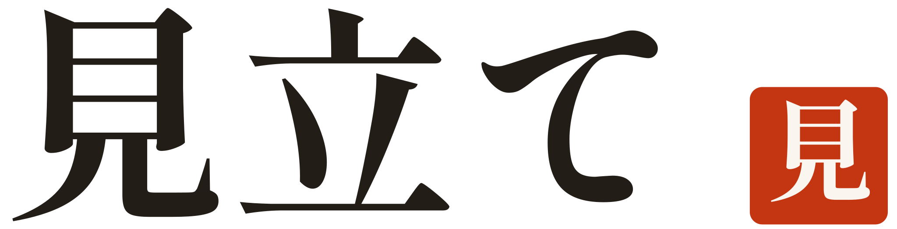
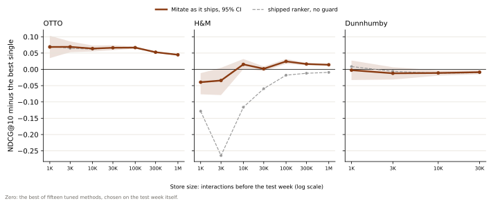

<p align="center">
  <picture>
    <source media="(prefers-color-scheme: dark)" srcset="docs/assets/banner-dark.svg">
    
  </picture>
</p>

<p align="center">
  <b>Mitate</b> &nbsp;·&nbsp; recommendations for the shop with three hundred products and forty regulars
</p>

<br>

**見立て** (*mitate*) is choosing something for someone with a discerning eye. A kimono seller
looks at a customer they have never served, reads what is in front of them, and knows which
cloth will suit. There is no purchase history to consult, only judgement.

Recommender systems are built for the opposite situation: millions of shoppers, years of
history, a team to tune them. A neighbourhood store that goes online has a catalogue, a few
hundred orders and nobody to tune anything. Mitate is a recommender for that store. It works
from the catalogue alone on the first day, gets better as orders arrive, and checks on the
store's own shoppers whether it is helping before it serves anything.

## What 90 stores taught it

The benchmark cuts three real retail datasets into simulated stores of every size, from 1K to 1M
shopping events, five stores per size: OTTO (general e-commerce), H&M (fashion) and Dunnhumby
(grocery). At each size Mitate is compared with the best of fifteen tuned methods, **chosen with
hindsight on the test week itself**, a bar no merchant could set.

**1. Learning to rank wins, at every size.** Nine methods each nominate products, and a
LambdaMART ranker orders the merged list. On OTTO it beats the leading method at all seven sizes
by 0.045 to 0.069 NDCG@10, although which method leads changes four times along the way.

**2. A ranker trained on one kind of shop can fail in another, and the shop cannot tell.** The
ranker Mitate ships learned from OTTO. On grocery it carries over. On fashion it scores below
plain recent popularity at every store size up to 30K events. Nothing on a merchant's dashboard would
have said so.

**3. So Mitate checks itself, then learns from the shop.** Before serving, the engine replays
the store's last week. It trains a second ranker on the store's own previous 14 days, and lets
everything compete on that week: the shipped ranker, the store's own ranker and each method
alone. Whichever ranked the store's real shoppers best is what the store gets. On fashion stores
from 100K events, that is the store's own ranker, **24% to 38% ahead of the best single method**.

<p align="center">
  
</p>

**4. In grocery, buying again is hard to beat.** Re-recommending a household's own most frequent
purchases is the best method at every size. Mitate puts repurchases first for returning
customers and matches it, but does not beat it.

### Mitate as it ships

NDCG@10 minus the best single method chosen on the test week, paired over the same shoppers, with
Holm correction across store sizes.

| Store size (events) | OTTO, next item | H&M, next basket | Dunnhumby, returning customers |
|---:|---:|---:|---:|
| 1K | **+0.069** · p 2 × 10⁻⁴ | −0.039 · p 0.12 | −0.004 · p 1 |
| 3K | **+0.069** · p 2 × 10⁻¹⁴ | −0.034 · p 0.23 | −0.004 · p 1 |
| 10K | **+0.064** · p 8 × 10⁻³⁹ | +0.015 · p 0.15 | +0.001 · p 1 |
| 30K | **+0.066** · p 1 × 10⁻⁶⁰ | +0.002 · p 0.62 | +0.005 · p 0.07 |
| 100K | **+0.067** · p < 10⁻³⁰⁰ | **+0.024** · p 3 × 10⁻⁹ | |
| 300K | **+0.053** · p < 10⁻³⁰⁰ | **+0.016** · p 2 × 10⁻¹⁷ | |
| 1M | **+0.045** · p < 10⁻³⁰⁰ | **+0.014** · p 2 × 10⁻⁴⁷ | |

<sub>Bold: significantly ahead after correction. No row is significantly behind. A 1K H&M store has
4 to 17 buying shoppers in its test week, so read the intervals in
[results.md](docs/results.md), not the point estimates. Dunnhumby has 2,500 households, so its
stores stop at 30K events.</sub>

<details>
<summary><b>The pre-registered headline: Mitate with a ranker trained on each dataset</b></summary>
<br>

This is the comparison the protocol fixed before any result: each dataset's own stores train the
ranker, which the product cannot always do (no ranker trained on H&M's non-commercial data may
ship). Protocol **Mitate-GTS v1** ([protocol.md](docs/protocol.md)).

**OTTO**, general e-commerce sessions (CC BY 4.0), next item:

| Store size (events) | Best single method, picked on the test week | Mitate | Difference, 95% CI | p (Holm) |
|---:|---|---:|---:|---:|
| 1K | Transition probe (PCTM) · 0.1762 | **0.2467** | +0.069 [+0.035, +0.103] | 1.6 × 10⁻⁴ |
| 3K | Session kNN (VSTAN) · 0.2155 | **0.2803** | +0.069 [+0.053, +0.086] | 1.6 × 10⁻¹⁴ |
| 10K | Session kNN (VSTAN) · 0.2130 | **0.2751** | +0.064 [+0.055, +0.073] | 8.2 × 10⁻³⁹ |
| 30K | GRU4Rec · 0.2160 | **0.2825** | +0.066 [+0.059, +0.074] | 1.1 × 10⁻⁶⁰ |
| 100K | iALS · 0.2196 | **0.2864** | +0.067 [+0.064, +0.070] | < 10⁻³⁰⁰ |
| 300K | SASRec · 0.2202 | **0.2728** | +0.053 [+0.051, +0.055] | < 10⁻³⁰⁰ |
| 1M | SASRec · 0.2274 | **0.2721** | +0.045 [+0.043, +0.047] | < 10⁻³⁰⁰ |

**H&M**, fashion, next basket:

| Store size (events) | Test shoppers per store | Best single method, picked on the test week | Mitate | Difference, 95% CI | p (Holm) |
|---:|---:|---|---:|---:|---:|
| 1K | 11 | Recent popularity · 0.1645 | **0.2825** | +0.116 [+0.048, +0.189] | 0.007 |
| 3K | 21 | Recent popularity · 0.3148 | 0.3018 | −0.013 [−0.059, +0.036] | 0.60 |
| 10K | 60 | Recent popularity · 0.1650 | **0.1855** | +0.021 [+0.005, +0.040] | 0.039 |
| 30K | 164 | Recent popularity · 0.1296 | **0.1596** | +0.031 [+0.017, +0.045] | 5.1 × 10⁻⁵ |
| 100K | 517 | Session kNN (VSTAN) · 0.0745 | **0.1122** | +0.032 [+0.026, +0.039] | 1.4 × 10⁻²¹ |
| 300K | 1,346 | Session kNN (VSTAN) · 0.0559 | **0.0897** | +0.029 [+0.025, +0.032] | 7.0 × 10⁻⁵⁵ |
| 1M | 3,947 | Session kNN (VSTAN) · 0.0573 | **0.0797** | +0.022 [+0.021, +0.024] | 9.8 × 10⁻¹⁴⁶ |

**Dunnhumby**, grocery, next basket:

| Store size (events) | Best single method | Mitate, ranker alone | Difference, 95% CI | p (Holm) |
|---:|---|---:|---:|---:|
| 1K | GP-TopFreq · 0.3910 | 0.3633 | −0.023 [−0.058, +0.012] | 0.43 |
| 3K | GP-TopFreq · 0.3159 | 0.3196 | +0.004 [−0.018, +0.026] | 0.75 |
| 10K | GP-TopFreq · 0.3284 | 0.3151 | −0.014 [−0.024, −0.002] | 0.066 |
| 30K | GP-TopFreq · 0.3199 | 0.3113 | −0.009 [−0.017, −0.001] | 0.066 |

On fashion stores from 100K events, the store's own ranker recovers 39% to 73% of the gap
between the guard alone and this H&M-trained ranker, with nothing trained on H&M shipped.

</details>

<details>
<summary><b>What else the ablations and the other datasets showed</b></summary>
<br>

* **The learning is what matters.** Replacing the ranker with plain rank fusion over the same
  nine sources costs 0.06 to 0.09 NDCG@10 on OTTO and 0.04 to 0.21 on H&M. Removing any one
  source mostly changes nothing measurable.
* **Store size is not what the ranker learns from.** Blanking its six store-size features changes
  nothing on OTTO, helps only at H&M 1K, and on Dunnhumby the ranker is better without them.
* **The guard knows when to leave a good ranker alone.** It kept the shipped ranker on all 35
  OTTO stores, the kind of shop it was trained on.
* **The store's own ranker is not a free win.** On grocery it trained on every store from 10K
  events and lost to both the shipped ranker and buy-again; the guard served it on one store of
  twenty. On fashion below 100K events it also loses, and is mostly turned away.
* **Fashion customers do not rebuy.** On H&M, the returning-customer rail scores below the ranker
  alone at six of seven sizes with the H&M-trained ranker, and at every size where the store's
  own ranker trained.

</details>

## How a store's week goes

```
   ◄──── older history ────►◄──── 14 days ────►◄──── last 7 days ────►│ today
   sources fitted here       the store's own     replay: every          │
                             ranker learns       candidate ranks the    │──► the winner serves
                             from what its       week's real shoppers   │    until the next fit
                             shoppers bought     (mean NDCG@10)         │

   candidates: the shipped ranker · the store's own ranker · each of the nine sources alone
```

Ties go to the shipped ranker. A store with too little history simply has fewer candidates: no
own ranker without older history before its 14 days or with fewer than 50 labelled purchases,
and no replay at all on day one.

```
 catalogue ─┬─► day one ─────────► text embeddings · approved category pairings · new arrivals ─┐
            │                                                                                    │
 orders ────┴─► nine candidate sources ──► ranker the ──► business rules ──► explanations ──────┴─► widget
                popularity · ItemKNN       replay chose    stock · region     counted, never
                RP3beta · EASE · iALS                      pins · blocks      invented
                PCTM · SeqRules · VSTAN                    price · diversity
                SASRec
```

| Placement | Day one (catalogue only) | Once shoppers arrive |
|---|---|---|
| Similar items | multilingual text embeddings of title, category, price band, description | same |
| Goes well with | category pairings the merchant approved, then related products from other categories | measured co-purchase first |
| You may also like | similarity to this visit, then new arrivals | the ranker the replay chose |
| Returning customers | as above | repurchases first, then that ranker |

* **Rules apply instantly.** Stock, delivery region (PIN prefix), pinned and blocked products,
  price sanity and category diversity act on every response without retraining.
* **Every reason is a count.** "34 shoppers who bought this also bought that." It is never
  generated and never shown from fewer than five shoppers.
* **It measures itself after launch too.** Holdout A/B tests on revenue per visitor with CUPED,
  team-draft interleaving, and a power calculator that tells a store when it is too small to run a
  test.
* **Private by construction.** Built for India's DPDP Act. No personal fields are accepted,
  shopper ids are HMAC pseudonyms, and recommendations wait for consent. Minors get a path with
  no profile, and erasing a shopper retrains the model without them.
* **Runs on a laptop.** FastAPI and SQLite on a CPU, with no external services.

## Keeping the numbers honest

A benchmark built by the people selling the method tends to find that the method wins. These are
the guards against that:

* **Decisions are written down before results.** The [research ledger](docs/research_ledger.md)
  records every protocol decision, what prompted it, and whether it was made before or after the
  result it affects. The guard and the store's own ranker were both registered before either had
  a single number.
* **The baseline is the hardest one available.** Mitate is compared with the best of fifteen
  methods tuned with the same budget, picked on the test week itself, not with a default.
* **Losses and ties stay in.** Grocery, the H&M 3K tie, the fashion failure of the shipped
  ranker, and a pre-registered dataset the own ranker could not be tested on (OTTO's four weeks
  are too short) are all reported where they happened.
* **The pipeline reproduced published results first.** EASE on MovieLens-20M scores Recall@20
  0.3905 against the published 0.391. GP-TopFreq on the Instacart split matches the authors' own
  code exactly.
* **No peeking at the future.** Predictions are bit-for-bit identical when everything after the
  cut date is replaced with noise, for every model and the whole pipeline, and the test suite
  enforces it.
* **No number is typed by hand.** Every table in [results.md](docs/results.md) is rendered by
  `python -m bench.report` from stored per-shopper result files.
* **Statistics match the question.** Paired tests over the same shoppers, Holm correction across
  store sizes for each claim, Benjamini-Yekutieli across exploratory tables.

The GPU work ran on free Kaggle T4s within a 30-hour weekly quota, the rest on an 8 GB Apple M1.
H&M data never leaves Kaggle; only the scores come back.

## See it

```bash
uv sync --group demo
uv run --group demo python -m serve.demo     # builds a synthetic shop in data/demo
MITATE_DATA_DIR=data/demo MITATE_DEMO_SITE=data/demo/site uv run python -m serve run
```

Open the storefront at `localhost:8000/demo/` and the merchant dashboard at
`localhost:8000/dashboard/`. The dashboard's private key is in `data/demo/keys.json`.

Press <kbd>X</kbd> on any page for the x-ray. For every rail it shows:
* the stage the store is in;
* the sources each product came from;
* the rules that held products back;
* the counted evidence behind every reason.

`?skin=thali|night|plain` restyles the host shop so you can watch the widget take on its look.

The demo shop is generated by [Misata](https://github.com/rasinmuhammed/misata) and labelled as
synthetic everywhere. It is never used for a benchmark number.

## Put it in a store

```bash
uv run python -m serve create-merchant "My Shop"   # prints a public and a private key, once
MITATE_DATA_DIR=data/serve uv run python -m serve run
curl -X POST localhost:8000/v1/catalog/import/shopify -H "X-Mitate-Key: sk_..." \
     --data-binary @products_export.csv
```

```html
<script src="https://your-host/widget/mitate.js" defer data-key="pk_..."
        data-api="https://your-host" data-url-template="/products/{id}"></script>
<div data-mitate="similar" data-item="SKU1"></div>
<script>Mitate.setConsent("granted") /* from your consent banner */</script>
```

The widget loads no fonts and makes no third-party requests. The API covers:
* catalogue import (Mitate CSV, Shopify and WooCommerce exports) and lookups;
* events;
* recommendations, single or batched, with explanations;
* status and daily totals;
* rules and complement-graph review;
* experiments, reports and the power calculator;
* shopper export and erasure.

Interactive docs are at `/docs` while the server runs.

## Reproduce

```bash
scripts/reproduce.sh   # data → reproductions → benchmark → online validation → efficiency → report
```

Large OTTO stores and all of H&M run on Kaggle GPUs (ledger D21 to D23):

```bash
scripts/kaggle/package.sh             # code and OTTO Parquet as a private dataset
scripts/kaggle/kernel.sh otto 30000   # one bucket of baselines on a T4
scripts/kaggle/collect.sh otto        # fetch, check hardware and run status, merge
scripts/kaggle/kernel.sh otto stage2  # Mitate itself, once every bucket is finished
scripts/kaggle/kernel.sh otto guard   # the guard and the store's own ranker
```

## Where it falls short

* The benchmark stores are slices of large marketplaces, not real small shops.
* Offline accuracy is not revenue. The online module is how a real store finds out. Its
  statistics are validated in simulation, and interleaving's sensitivity on real small-store
  traffic is unverified.
* On fashion, Mitate beats the best single method only from 100K events. Below that it is level,
  and at 1K and 3K it is 0.03 to 0.04 behind (not significant): a week of 10 to 20 shoppers
  sometimes points the replay at the wrong method.
* The store's own ranker needs history before its 14 training days. OTTO's four weeks, with two
  held out for validation and test, leave none, so it was never tested there.
* In grocery Mitate matches buying again; it does not beat it. Dunnhumby has only 2,500
  households, so grocery is measured on stores of up to 30K events.
* The dense item-item models assume catalogues of up to about 25K products.

## Read more

[Explainer](docs/explainer.md) · [Protocol](docs/protocol.md) ·
[Store simulation](docs/store_simulation.md) · [Results](docs/results.md) ·
[Research ledger](docs/research_ledger.md) · [Model card](docs/model_card.md) ·
[Privacy](docs/privacy.md) · [Licenses](docs/licenses.md)

## License

Mitate is source-available under the
[PolyForm Noncommercial License 1.0.0](LICENSE.md).

**Free to use for any noncommercial purpose**, including:
* reading, running, changing and sharing the code;
* personal projects, study, research and teaching;
* use by charities, schools, public research bodies and government.

**Commercial use needs a license from the author.** That covers:
* running Mitate for a business;
* offering it as a hosted service;
* building it into a product you sell.

To ask about a commercial license, contact [@rasinmuhammed](https://github.com/rasinmuhammed).

**Third-party material keeps its own license.** The full list is in [NOTICE](NOTICE):
* The pretrained rankers are trained on the OTTO session dataset by OTTO GmbH & Co KG
  (CC BY 4.0, DOI 10.34740/KAGGLE/DSV/4991874).
* The interface fonts are under the SIL Open Font License 1.1.
* No other benchmark dataset is redistributed. Their terms are in
  [docs/licenses.md](docs/licenses.md).

By opening a pull request, you agree that your contribution may be distributed under this
license and under the author's commercial licenses.

<sub>Copyright 2026 Muhammed Rasin O M</sub>
