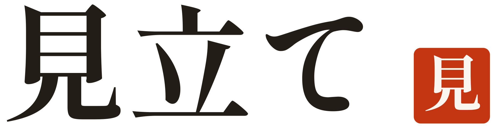
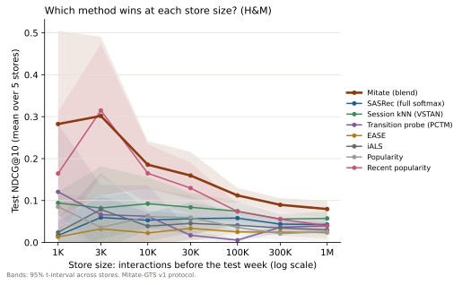

<p align="center">
  <picture>
    <source media="(prefers-color-scheme: dark)" srcset="docs/assets/banner-dark.svg">
    
  </picture>
</p>

<p align="center">
  <b>Mitate</b> &nbsp;·&nbsp; recommendations for the shop with three hundred products and forty regulars
</p>

<br>

**見立て** (*mitate*) is choosing something for someone with a discerning eye. A kimono seller
looks at a customer they have never served, reads what is in front of them, and knows which
cloth will suit. There is no purchase history to consult, only judgement.

Recommender systems are built for the opposite situation: millions of shoppers, years of
history, a team to tune them. A neighbourhood store that goes online has a catalogue, a few
hundred orders and nobody to tune anything. Mitate is a recommender for that store. It is useful
from the catalogue alone on the first day, it gets better as orders arrive, and it measures
whether it is helping instead of assuming so.

## The right method depends on the size of the shop

Cut a real retail dataset into stores of every size and the best recommender keeps changing. On
H&M fashion data, recent popularity beats every learned model in stores of up to 30K shopping
events; from 100K, session kNN takes over. Any single method is the wrong choice somewhere in a
store's life, and the store cannot see where: at small sizes, the test windows are too noisy to
compare methods by eye.

Mitate doesn't pick one. A LambdaMART ranker reads the candidates from nine methods side by side,
together with how big the store is, and learns from stores of every size when to trust which.

<p align="center">
  
</p>

## Results

Next-basket recommendation on H&M (ledger D22), protocol **Mitate-GTS v1**
([protocol.md](docs/protocol.md)):
* five simulated stores per size, sampled from real transactions;
* a global temporal split, with the last week held out;
* ranking over the full catalogue;
* fifteen baselines, each tuned with the same budget.

Mitate is compared with the best of those fifteen chosen *with hindsight*, on the test week
itself, paired over the same shoppers, with Holm correction across the seven sizes.

| Store size (events) | Test shoppers per store | Best single method, picked on the test week | Mitate | Difference, 95% CI | p (Holm) |
|---:|---:|---|---:|---:|---:|
| 1K | 11 | Recent popularity · 0.1645 | **0.2825** | +0.116 [+0.048, +0.189] | 0.007 |
| 3K | 21 | Recent popularity · 0.3148 | 0.3018 | −0.013 [−0.059, +0.036] | 0.60 |
| 10K | 60 | Recent popularity · 0.1650 | **0.1855** | +0.021 [+0.005, +0.040] | 0.039 |
| 30K | 164 | Recent popularity · 0.1296 | **0.1596** | +0.031 [+0.017, +0.045] | 5.1 × 10⁻⁵ |
| 100K | 517 | Session kNN (VSTAN) · 0.0745 | **0.1122** | +0.032 [+0.026, +0.039] | 1.4 × 10⁻²¹ |
| 300K | 1,346 | Session kNN (VSTAN) · 0.0559 | **0.0897** | +0.029 [+0.025, +0.032] | 7.0 × 10⁻⁵⁵ |
| 1M | 3,947 | Session kNN (VSTAN) · 0.0573 | **0.0797** | +0.022 [+0.021, +0.024] | 9.8 × 10⁻¹⁴⁶ |

<sub>NDCG@10 on the held-out week, mean over five stores. Full tables, every baseline, and
Recall@20 are in [results.md](docs/results.md).</sub>

* **Six of seven sizes won** against a baseline nobody could actually pick in advance. At 3K
  events it is a tie, and that row stays in.
* **Against the choice a merchant can actually make** (whichever baseline did best on the
  store's own validation week), Mitate's 95% interval is above zero at every size.
* **The learning is what matters.** Replacing the ranker with plain rank fusion over the same
  nine sources costs 0.04 to 0.21 NDCG@10. Removing any one source mostly changes nothing
  measurable: the ranker leans on whichever sources remain.
* **Small means few.** A 1K store has 4 to 17 buying shoppers in its test week. Read the
  intervals, not the point estimates.

On this benchmark, H&M next-basket stores of 1K to 1M events, Mitate is significantly ahead of
every baseline we tuned at six of seven sizes. That is the claim; nothing broader is.

**OTTO** (anonymous e-commerce sessions, CC BY 4.0): every baseline is finished at all seven
sizes, and Mitate's own run is in progress. Its table lands here when it finishes, including any
size where Mitate loses.

**Before any of this was trusted, the pipeline had to pass two checks:**
* It reproduced two published results. EASE on MovieLens-20M scores Recall@20 0.3905 against
  the published 0.391. GP-TopFreq on the Instacart split matches the authors' own code exactly.
* Predictions are bit-for-bit identical when everything after the cut date is replaced with
  noise. That holds for every model and for the whole pipeline, and the test suite enforces it.

## How it decides

```
 catalogue ─┬─► day one ─────────► text embeddings · approved category pairings · new arrivals ─┐
            │                                                                                    │
 orders ────┴─► nine candidate sources ──► learned ranker ──► business rules ──► explanations ──┴─► widget
                popularity · ItemKNN       LambdaMART,         stock · region     counted, never
                RP3beta · EASE · iALS      trained across      pins · blocks      invented
                PCTM · SeqRules · VSTAN    stores of every     price · diversity
                SASRec                     size
```

| Placement | Day one (catalogue only) | Once shoppers arrive |
|---|---|---|
| Similar items | multilingual text embeddings of title, category, price band, description | same |
| Goes well with | category pairings the merchant approved, then related products from other categories | measured co-purchase first |
| You may also like | similarity to this visit, then new arrivals | the learned ranker |
| Returning customers | as above | repurchases first, then the ranker |

* **Rules apply instantly.** Stock, delivery region (PIN prefix), pinned and blocked products,
  price sanity and category diversity act on every response without retraining.
* **Every reason is a count.** "34 shoppers who bought this also bought that." It is never
  generated and never shown from fewer than five shoppers.
* **It measures itself.** Holdout A/B tests on revenue per visitor with CUPED, team-draft
  interleaving, and a power calculator that tells a store when it is too small to run a test.
* **Private by construction.** Built for India's DPDP Act. No personal fields are accepted,
  shopper ids are HMAC pseudonyms, and recommendations wait for consent. Minors get a path with
  no profile, and erasing a shopper retrains the model without them.
* **Runs on a laptop.** FastAPI and SQLite on a CPU, with no external services.

## See it

```bash
uv sync --group demo
uv run --group demo python -m serve.demo     # builds a synthetic shop in data/demo
MITATE_DATA_DIR=data/demo MITATE_DEMO_SITE=data/demo/site uv run python -m serve run
```

Open the storefront at `localhost:8000/demo/` and the merchant dashboard at
`localhost:8000/dashboard/`. The dashboard's private key is in `data/demo/keys.json`.

Press <kbd>X</kbd> on any page for the x-ray. For every rail it shows:
* the stage the store is in;
* the sources each product came from;
* the rules that held products back;
* the counted evidence behind every reason.

`?skin=thali|night|plain` restyles the host shop so you can watch the widget take on its look.

The demo shop is generated by [Misata](https://github.com/rasinmuhammed/misata) and labelled as
synthetic everywhere. It is never used for a benchmark number.

## Put it in a store

```bash
uv run python -m serve create-merchant "My Shop"   # prints a public and a private key, once
MITATE_DATA_DIR=data/serve uv run python -m serve run
curl -X POST localhost:8000/v1/catalog/import/shopify -H "X-Mitate-Key: sk_..." \
     --data-binary @products_export.csv
```

```html
<script src="https://your-host/widget/mitate.js" defer data-key="pk_..."
        data-api="https://your-host" data-url-template="/products/{id}"></script>
<div data-mitate="similar" data-item="SKU1"></div>
<script>Mitate.setConsent("granted") /* from your consent banner */</script>
```

The widget loads no fonts and makes no third-party requests. The API covers:
* catalogue import (Mitate CSV, Shopify and WooCommerce exports) and lookups;
* events;
* recommendations, single or batched, with explanations;
* status and daily totals;
* rules and complement-graph review;
* experiments, reports and the power calculator;
* shopper export and erasure.

Interactive docs are at `/docs` while the server runs.

## Reproduce

```bash
scripts/reproduce.sh   # data → reproductions → benchmark → online validation → efficiency → report
```

Every number in [results.md](docs/results.md) is written by `python -m bench.report` from a
stored result file. None is typed in by hand.

Large OTTO stores and all of H&M run on Kaggle GPUs (ledger D21 to D23). H&M data never leaves
Kaggle; only the scores come back.

```bash
scripts/kaggle/package.sh             # code and OTTO Parquet as a private dataset
scripts/kaggle/kernel.sh otto 30000   # one bucket of baselines on a T4
scripts/kaggle/collect.sh otto        # fetch, check hardware and run status, merge
scripts/kaggle/kernel.sh otto stage2  # Mitate itself, once every bucket is finished
```

Every decision that shaped the protocol is in the [research ledger](docs/research_ledger.md),
including the ones made after a result was seen. Each entry records when it was made.

## Where it falls short

* The benchmark stores are slices of large marketplaces, not real small shops.
* Offline accuracy is not revenue. The online module is how a real store finds out. Its
  statistics are validated in simulation, and interleaving's sensitivity on real small-store
  traffic is unverified.
* Grocery repeat purchase (Dunnhumby) is waiting on dataset terms.
* The dense item-item models assume catalogues of up to about 25K products.

## Read more

[Explainer](docs/explainer.md) · [Protocol](docs/protocol.md) ·
[Store simulation](docs/store_simulation.md) · [Results](docs/results.md) ·
[Research ledger](docs/research_ledger.md) · [Model card](docs/model_card.md) ·
[Privacy](docs/privacy.md) · [Licenses](docs/licenses.md)

## License

Mitate is source-available under the
[PolyForm Noncommercial License 1.0.0](LICENSE.md).

**Free to use for any noncommercial purpose**, including:
* reading, running, changing and sharing the code;
* personal projects, study, research and teaching;
* use by charities, schools, public research bodies and government.

**Commercial use needs a license from the author.** That covers:
* running Mitate for a business;
* offering it as a hosted service;
* building it into a product you sell.

To ask about a commercial license, contact [@rasinmuhammed](https://github.com/rasinmuhammed).

**Third-party material keeps its own license.** The full list is in [NOTICE](NOTICE):
* The pretrained rankers are trained on the OTTO session dataset by OTTO GmbH & Co KG
  (CC BY 4.0, DOI 10.34740/KAGGLE/DSV/4991874).
* The interface fonts are under the SIL Open Font License 1.1.
* No other benchmark dataset is redistributed. Their terms are in
  [docs/licenses.md](docs/licenses.md).

By opening a pull request, you agree that your contribution may be distributed under this
license and under the author's commercial licenses.

<sub>Copyright 2026 Muhammed Rasin O M</sub>
