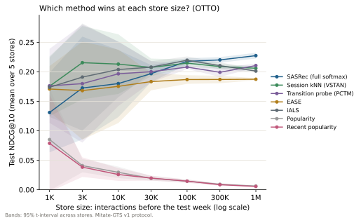
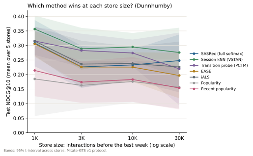

<!-- Generated by `python -m bench.report` from docs/results.template.md and stored results. Do not edit by hand. -->

# Results

Every number on this page is read from a stored result file by `python -m bench.report`. A
table that has not been computed says *Not run yet*; nothing here is estimated or carried over
by hand. The protocol is in [protocol.md](protocol.md) and every decision that shaped it, with
its timing, is in the [research ledger](research_ledger.md).

**How to read the tables**

* Scores are test-window NDCG@10: the mean over stores, ± the half-width of a 95% t-interval
  across stores.
* "Mitate vs …" rows are paired tests on the same test units (shoppers for ranking, anchor
  products for placements), with a 95% interval on the difference and Holm-adjusted p-values
  across store sizes.
* "The baseline each store picks" is the baseline with the best score on that store's own
  validation data, which is the choice a merchant could make without seeing the test. "Oracle"
  is the best baseline on the test data itself, an upper bound no one can pick in advance.
* The means table weights every store equally; the paired tests weight every test unit
  equally. Where a store has very few test units (some 1K placement stores have one to four
  anchors), the two can disagree, and the paired test is the one to trust.
* Ranking stores use seeds 0–4, with spare seeds for a store that cannot be evaluated (ledger
  D24). Placement stores use seeds 1–5: seed 0 was the placement development store, where
  design decisions were made after looking at its numbers, and is never reported.

## 1. Ranking: which method wins at each store size (OTTO)

Store sizes are the number of shopper events before the test cut; catalog size grows with them
([store_simulation.md](store_simulation.md)). Above 10K events, tuning follows ledger D18. Every
ranking result on this page was computed on Kaggle (Tesla T4, ledger D21 and D23); each run's
hardware record is stored with its results.

| Store size | Stores | Products per store | Test shoppers per store: mean (range) | Seeds passed over |
|---|---:|---:|---:|---:|
| 1K | 5 | 168 | 24 (20 to 27) | 0 |
| 3K | 5 | 349 | 68 (48 to 78) | 0 |
| 10K | 5 | 752 | 199 (168 to 253) | 0 |
| 30K | 5 | 1474 | 499 (468 to 567) | 0 |
| 100K | 5 | 2988 | 1676 (1628 to 1755) | 0 |
| 300K | 5 | 5991 | 2622 (2568 to 2655) | 0 |
| 1M | 5 | 11995 | 2820 (2803 to 2850) | 0 |

| Store size | Stores | Mitate | Best single (chosen on test) | Δ vs best, 95% CI | d_z | p (Holm) | Stores where Mitate ≥ best | Δ vs validation-selected single, 95% CI |
|---|---:|---:|---|---:|---:|---:|---:|---:|
| 1K | 5 | 0.2467 | Transition probe (PCTM) 0.1762 | +0.0687 [+0.0345, +0.1030] | +0.35 | 0.000162 | 5/5 | +0.0858 [+0.0548, +0.1188] |
| 3K | 5 | 0.2803 | Session kNN (VSTAN) 0.2155 | +0.0691 [+0.0527, +0.0857] | +0.44 | 1.59e-14 | 5/5 | +0.0705 [+0.0537, +0.0878] |
| 10K | 5 | 0.2751 | Session kNN (VSTAN) 0.2130 | +0.0638 [+0.0547, +0.0733] | +0.43 | 8.19e-39 | 5/5 | +0.0700 [+0.0601, +0.0799] |
| 30K | 5 | 0.2825 | GRU4Rec 0.2160 | +0.0663 [+0.0588, +0.0740] | +0.34 | 1.1e-60 | 5/5 | +0.0749 [+0.0690, +0.0808] |
| 100K | 5 | 0.2864 | iALS 0.2196 | +0.0668 [+0.0637, +0.0698] | +0.47 | 0 | 5/5 | +0.0710 [+0.0681, +0.0738] |
| 300K | 5 | 0.2728 | SASRec (full softmax) 0.2202 | +0.0526 [+0.0505, +0.0548] | +0.42 | 0 | 5/5 | +0.0598 [+0.0574, +0.0621] |
| 1M | 5 | 0.2721 | SASRec (full softmax) 0.2274 | +0.0447 [+0.0428, +0.0466] | +0.39 | 0 | 5/5 | +0.0447 [+0.0428, +0.0466] |

All models, NDCG@10:

| Model | 1K | 3K | 10K | 30K | 100K | 300K | 1M |
|---|---:|---:|---:|---:|---:|---:|---:|
| Mitate (blend) | 0.2467 ± 0.0739 | 0.2803 ± 0.0912 | 0.2751 ± 0.0642 | 0.2825 ± 0.0178 | 0.2864 ± 0.0079 | 0.2728 ± 0.0059 | 0.2721 ± 0.0045 |
| BPR | 0.1739 ± 0.0445 | 0.2004 ± 0.0547 | 0.1958 ± 0.0449 | 0.2026 ± 0.0066 | 0.2015 ± 0.0027 | 0.1908 ± 0.0033 | 0.1889 ± 0.0046 |
| EASE | 0.1708 ± 0.0389 | 0.1681 ± 0.0831 | 0.1754 ± 0.0623 | 0.1834 ± 0.0148 | 0.1869 ± 0.0073 | 0.1870 ± 0.0064 | 0.1874 ± 0.0018 |
| GRU4Rec | 0.1338 ± 0.1061 | 0.1921 ± 0.1121 | 0.2042 ± 0.0747 | **0.2160 ± 0.0199** | – | – | – |
| ItemKNN | 0.1613 ± 0.0231 | 0.1651 ± 0.0863 | 0.1715 ± 0.0602 | 0.1779 ± 0.0182 | 0.1841 ± 0.0057 | 0.1741 ± 0.0085 | 0.1792 ± 0.0029 |
| Markov chain | 0.1577 ± 0.0958 | 0.1585 ± 0.0889 | 0.1670 ± 0.0552 | 0.1711 ± 0.0122 | 0.1837 ± 0.0048 | 0.1850 ± 0.0067 | 0.1948 ± 0.0040 |
| Popularity | 0.0851 ± 0.0866 | 0.0409 ± 0.0114 | 0.0295 ± 0.0098 | 0.0193 ± 0.0040 | 0.0146 ± 0.0027 | 0.0092 ± 0.0019 | 0.0062 ± 0.0008 |
| RP3beta | 0.1666 ± 0.0304 | 0.1792 ± 0.0899 | 0.1829 ± 0.0611 | 0.1904 ± 0.0164 | 0.1920 ± 0.0066 | 0.1938 ± 0.0099 | 0.1928 ± 0.0030 |
| Recent popularity | 0.0787 ± 0.0823 | 0.0383 ± 0.0166 | 0.0258 ± 0.0109 | 0.0197 ± 0.0043 | 0.0145 ± 0.0026 | 0.0085 ± 0.0019 | 0.0056 ± 0.0002 |
| SASRec (full softmax) | 0.1310 ± 0.0675 | 0.1725 ± 0.0871 | 0.1801 ± 0.0569 | 0.1969 ± 0.0144 | 0.2177 ± 0.0054 | **0.2202 ± 0.0048** | **0.2274 ± 0.0048** |
| SeqRules | 0.1709 ± 0.0846 | 0.1788 ± 0.0856 | 0.1925 ± 0.0476 | 0.1889 ± 0.0165 | 0.2060 ± 0.0031 | 0.2037 ± 0.0060 | 0.2073 ± 0.0020 |
| Session kNN (VSTAN) | 0.1756 ± 0.0508 | **0.2155 ± 0.0621** | **0.2130 ± 0.0506** | 0.2075 ± 0.0150 | 0.2147 ± 0.0061 | 0.2089 ± 0.0042 | 0.2060 ± 0.0035 |
| Transition probe (PCTM) | **0.1762 ± 0.0628** | 0.1799 ± 0.1001 | 0.1966 ± 0.0547 | 0.2002 ± 0.0181 | 0.2080 ± 0.0033 | 0.1992 ± 0.0079 | 0.2106 ± 0.0033 |
| eSASRec | 0.1142 ± 0.0953 | 0.1494 ± 0.0964 | 0.1634 ± 0.0520 | 0.1803 ± 0.0143 | – | – | – |
| gSASRec (tuned k, t) | 0.0615 ± 0.0784 | 0.1035 ± 0.1198 | 0.1547 ± 0.0626 | 0.0896 ± 0.1201 | – | – | – |
| iALS | 0.1737 ± 0.0503 | 0.1911 ± 0.0909 | 0.2038 ± 0.0469 | 0.2079 ± 0.0100 | **0.2196 ± 0.0064** | 0.2104 ± 0.0058 | 0.2013 ± 0.0025 |

All models, Recall@20:

| Model | 1K | 3K | 10K | 30K | 100K | 300K | 1M |
|---|---:|---:|---:|---:|---:|---:|---:|
| Mitate (blend) | 0.5165 ± 0.0984 | 0.5361 ± 0.1459 | 0.5290 ± 0.1294 | 0.5555 ± 0.0302 | 0.5717 ± 0.0096 | 0.5515 ± 0.0047 | 0.5442 ± 0.0055 |
| BPR | 0.4618 ± 0.0825 | 0.4689 ± 0.0995 | **0.4807 ± 0.1371** | 0.4874 ± 0.0251 | 0.4903 ± 0.0075 | 0.4646 ± 0.0071 | 0.4644 ± 0.0075 |
| EASE | 0.3804 ± 0.0834 | 0.4161 ± 0.1644 | 0.3972 ± 0.1226 | 0.4004 ± 0.0208 | 0.4151 ± 0.0117 | 0.4223 ± 0.0109 | 0.4165 ± 0.0035 |
| GRU4Rec | 0.2773 ± 0.1222 | 0.4441 ± 0.1687 | 0.4615 ± 0.1295 | 0.4828 ± 0.0318 | – | – | – |
| ItemKNN | 0.3642 ± 0.0761 | 0.3614 ± 0.1286 | 0.3610 ± 0.1535 | 0.3961 ± 0.0289 | 0.3832 ± 0.0111 | 0.3451 ± 0.0130 | 0.3816 ± 0.0032 |
| Markov chain | 0.3486 ± 0.1420 | 0.3111 ± 0.1277 | 0.3331 ± 0.0881 | 0.3358 ± 0.0176 | 0.3719 ± 0.0050 | 0.3800 ± 0.0099 | 0.4046 ± 0.0062 |
| Popularity | 0.2529 ± 0.1625 | 0.1691 ± 0.0608 | 0.1201 ± 0.0304 | 0.0696 ± 0.0201 | 0.0492 ± 0.0055 | 0.0317 ± 0.0042 | 0.0226 ± 0.0013 |
| RP3beta | 0.3792 ± 0.0725 | 0.4292 ± 0.1668 | 0.4240 ± 0.1294 | 0.3915 ± 0.0285 | 0.4579 ± 0.0120 | 0.4390 ± 0.0124 | 0.4605 ± 0.0049 |
| Recent popularity | 0.2452 ± 0.1552 | 0.1353 ± 0.0418 | 0.0841 ± 0.0255 | 0.0731 ± 0.0107 | 0.0492 ± 0.0055 | 0.0332 ± 0.0041 | 0.0210 ± 0.0018 |
| SASRec (full softmax) | 0.3757 ± 0.0760 | 0.4216 ± 0.1838 | 0.4649 ± 0.1719 | **0.5060 ± 0.0393** | **0.5357 ± 0.0045** | 0.5061 ± 0.0103 | **0.5117 ± 0.0060** |
| SeqRules | 0.3716 ± 0.1243 | 0.4061 ± 0.1468 | 0.4364 ± 0.1018 | 0.4327 ± 0.0250 | 0.4679 ± 0.0047 | 0.4695 ± 0.0121 | 0.4767 ± 0.0063 |
| Session kNN (VSTAN) | **0.4693 ± 0.1426** | **0.4864 ± 0.1337** | 0.4799 ± 0.1015 | 0.4634 ± 0.0267 | 0.5046 ± 0.0115 | 0.4921 ± 0.0106 | 0.4985 ± 0.0048 |
| Transition probe (PCTM) | 0.3453 ± 0.1026 | 0.4096 ± 0.1579 | 0.4323 ± 0.1157 | 0.4424 ± 0.0190 | 0.4722 ± 0.0065 | 0.4679 ± 0.0125 | 0.4832 ± 0.0052 |
| eSASRec | 0.3125 ± 0.1201 | 0.4036 ± 0.2423 | 0.4469 ± 0.1397 | 0.4766 ± 0.0349 | – | – | – |
| gSASRec (tuned k, t) | 0.1429 ± 0.0935 | 0.2942 ± 0.2827 | 0.4215 ± 0.1550 | 0.2440 ± 0.2931 | – | – | – |
| iALS | 0.4482 ± 0.0958 | 0.4274 ± 0.2228 | 0.4664 ± 0.1064 | 0.4642 ± 0.0232 | 0.5069 ± 0.0127 | **0.5221 ± 0.0047** | 0.5045 ± 0.0087 |

### What drives the result

What each piece of Mitate contributes: Mitate minus a version of it with that piece removed,
paired over the same shoppers (positive means the piece helps; *n.s.* means not significant
after Benjamini-Yekutieli correction across all ablations of the dataset):

| Removed | 1K | 3K | 10K | 30K | 100K | 300K | 1M |
|---|---:|---:|---:|---:|---:|---:|---:|
| Learned ranking (rank fusion instead) | +0.0583 (n.s.) | +0.0922 | +0.0747 | +0.0702 | +0.0684 | +0.0578 | +0.0576 |
| Store-size features | -0.0083 (n.s.) | +0.0001 (n.s.) | +0.0012 (n.s.) | +0.0003 (n.s.) | -0.0014 (n.s.) | -0.0011 (n.s.) | +0.0004 (n.s.) |
| Source: Recent popularity | -0.0150 (n.s.) | -0.0041 (n.s.) | -0.0017 (n.s.) | -0.0010 (n.s.) | -0.0020 (n.s.) | -0.0029 | -0.0014 (n.s.) |
| Source: ItemKNN | -0.0050 (n.s.) | -0.0057 (n.s.) | +0.0004 (n.s.) | +0.0005 (n.s.) | -0.0015 (n.s.) | -0.0022 | -0.0006 (n.s.) |
| Source: RP3beta | -0.0093 (n.s.) | -0.0072 (n.s.) | -0.0009 (n.s.) | -0.0007 (n.s.) | -0.0013 (n.s.) | -0.0023 | -0.0006 (n.s.) |
| Source: EASE | +0.0053 (n.s.) | +0.0045 (n.s.) | +0.0039 (n.s.) | -0.0013 (n.s.) | +0.0037 | +0.0006 (n.s.) | +0.0011 (n.s.) |
| Source: iALS | -0.0073 (n.s.) | -0.0110 (n.s.) | -0.0007 (n.s.) | -0.0016 (n.s.) | -0.0004 (n.s.) | -0.0007 (n.s.) | +0.0001 (n.s.) |
| Source: Transition probe (PCTM) | -0.0095 (n.s.) | -0.0016 (n.s.) | +0.0031 (n.s.) | -0.0031 (n.s.) | -0.0008 (n.s.) | -0.0014 (n.s.) | -0.0006 (n.s.) |
| Source: SeqRules | -0.0003 (n.s.) | -0.0046 (n.s.) | -0.0003 (n.s.) | -0.0009 (n.s.) | -0.0027 | -0.0012 (n.s.) | -0.0003 (n.s.) |
| Source: Session kNN (VSTAN) | -0.0026 (n.s.) | +0.0071 (n.s.) | +0.0029 (n.s.) | -0.0017 (n.s.) | +0.0006 (n.s.) | -0.0007 (n.s.) | -0.0004 (n.s.) |
| Source: SASRec (full softmax) | -0.0061 (n.s.) | +0.0075 (n.s.) | +0.0077 (n.s.) | +0.0089 | +0.0019 (n.s.) | +0.0025 | +0.0049 |

### Cost

Peak memory and wall time per model, measured one at a time on an otherwise idle Apple M1 (8 GB):

_Not measured yet._

### Same stores, another machine

OTTO stores of 1K–10K events were first run on an Apple M1 and then rerun from scratch on Kaggle
(ledger D23): the same sampled stores (checked bit for bit, `bench.fingerprint`), the same
configuration and seeds. Only models finished on both machines are listed.

| Store size | Model | Stores | otto-m1 | otto | Δ mean | Largest Δ on one store |
|---|---|---:|---:|---:|---:|---:|
| 1K | BPR | 5 | 0.1913 | 0.1844 | -0.0069 | -0.0400 |
| 1K | EASE | 5 | 0.1641 | 0.1589 | -0.0052 | -0.0291 |
| 1K | eSASRec | 5 | 0.0964 | 0.1115 | +0.0150 | +0.0597 |
| 1K | gSASRec (tuned k, t) | 5 | 0.0640 | 0.0562 | -0.0078 | -0.0154 |
| 1K | iALS | 5 | 0.2024 | 0.1929 | -0.0096 | -0.0295 |
| 1K | ItemKNN | 5 | 0.1561 | 0.1496 | -0.0066 | -0.0227 |
| 1K | Markov chain | 5 | 0.1407 | 0.1407 | +0.0000 | +0.0000 |
| 1K | Transition probe (PCTM) | 5 | 0.1572 | 0.1626 | +0.0054 | +0.0269 |
| 1K | Popularity | 5 | 0.0717 | 0.0717 | +0.0000 | +0.0000 |
| 1K | Recent popularity | 5 | 0.0662 | 0.0662 | +0.0000 | +0.0000 |
| 1K | RP3beta | 5 | 0.1576 | 0.1527 | -0.0049 | -0.0283 |
| 1K | SASRec (full softmax) | 5 | 0.0991 | 0.1354 | +0.0363 | +0.0984 |
| 1K | SeqRules | 5 | 0.1611 | 0.1611 | +0.0000 | +0.0000 |
| 1K | Session kNN (VSTAN) | 5 | 0.2100 | 0.2100 | +0.0000 | +0.0000 |
| 3K | BPR | 5 | 0.1988 | 0.2226 | +0.0238 | +0.1402 |
| 3K | EASE | 5 | 0.1651 | 0.1654 | +0.0003 | +0.0019 |
| 3K | eSASRec | 5 | 0.1368 | 0.1427 | +0.0059 | +0.0281 |
| 3K | gSASRec (tuned k, t) | 5 | 0.1010 | 0.1095 | +0.0085 | +0.1888 |
| 3K | iALS | 5 | 0.2355 | 0.2219 | -0.0136 | -0.0622 |
| 3K | ItemKNN | 5 | 0.1668 | 0.1669 | +0.0001 | +0.0049 |
| 3K | Markov chain | 5 | 0.1496 | 0.1496 | +0.0000 | +0.0000 |
| 3K | Transition probe (PCTM) | 5 | 0.1766 | 0.1907 | +0.0141 | +0.0396 |
| 3K | Popularity | 5 | 0.0396 | 0.0396 | +0.0000 | +0.0000 |
| 3K | Recent popularity | 5 | 0.0352 | 0.0352 | +0.0000 | +0.0000 |
| 3K | RP3beta | 5 | 0.1717 | 0.1716 | -0.0001 | -0.0050 |
| 3K | SASRec (full softmax) | 5 | 0.1670 | 0.1742 | +0.0072 | +0.0370 |
| 3K | SeqRules | 5 | 0.1834 | 0.1834 | +0.0000 | +0.0000 |
| 3K | Session kNN (VSTAN) | 5 | 0.2589 | 0.2606 | +0.0017 | +0.0085 |
| 10K | BPR | 2 | 0.2308 | 0.2202 | -0.0105 | -0.0163 |
| 10K | EASE | 2 | 0.1616 | 0.1597 | -0.0019 | -0.0038 |
| 10K | eSASRec | 1 | 0.2200 | 0.1994 | -0.0206 | -0.0206 |
| 10K | gSASRec (tuned k, t) | 1 | 0.2065 | 0.2051 | -0.0014 | -0.0014 |
| 10K | iALS | 2 | 0.2402 | 0.2388 | -0.0014 | -0.0027 |
| 10K | ItemKNN | 2 | 0.1594 | 0.1583 | -0.0011 | -0.0024 |
| 10K | Markov chain | 2 | 0.1495 | 0.1495 | +0.0000 | +0.0000 |
| 10K | Transition probe (PCTM) | 2 | 0.1953 | 0.1953 | +0.0000 | +0.0000 |
| 10K | Popularity | 2 | 0.0248 | 0.0248 | +0.0000 | +0.0000 |
| 10K | Recent popularity | 2 | 0.0225 | 0.0225 | +0.0000 | +0.0000 |
| 10K | RP3beta | 2 | 0.1716 | 0.1716 | +0.0000 | +0.0000 |
| 10K | SASRec (full softmax) | 1 | 0.2297 | 0.2247 | -0.0050 | -0.0050 |
| 10K | SeqRules | 2 | 0.1925 | 0.1924 | -0.0001 | -0.0002 |
| 10K | Session kNN (VSTAN) | 2 | 0.2503 | 0.2503 | +0.0000 | +0.0000 |

**Reading this table.** Models with nothing to tune and no randomness (VSTAN, SeqRules, the
Markov chain, popularity) agree to the last digit, which confirms the stores are identical. Tuned
models differ, even deterministic ones such as EASE and ItemKNN: floating-point results differ
slightly between machines, and that is enough to send the 30-trial search down a different path
after its first identical trials, to different hyperparameters. The differences therefore measure
tuning variance at a fixed budget. On a single small store they can reach several hundredths of
NDCG@10, which is why the comparisons above pair shoppers across all five stores of a size
instead of reading any one store.

## 2. Ranking: fashion, next basket (H&M)

Next-basket recommendation for returning customers: one basket per customer-day, test on the last
week of the competition's training file (ledger D22). The H&M data never leaves Kaggle; only the
scores below do. Small fashion stores see few buying shoppers in a test week, so read the paired
tests, and the shopper counts here, before the means:

| Store size | Stores | Products per store | Test shoppers per store: mean (range) | Seeds passed over |
|---|---:|---:|---:|---:|
| 1K | 5 | 163 | 11 (4 to 17) | 1 |
| 3K | 5 | 366 | 21 (9 to 33) | 0 |
| 10K | 5 | 762 | 60 (27 to 83) | 0 |
| 30K | 5 | 1461 | 164 (78 to 237) | 0 |
| 100K | 5 | 2971 | 517 (208 to 750) | 0 |
| 300K | 5 | 5979 | 1346 (495 to 1847) | 0 |
| 1M | 5 | 11286 | 3947 (3445 to 4586) | 0 |

| Store size | Stores | Mitate | Best single (chosen on test) | Δ vs best, 95% CI | d_z | p (Holm) | Stores where Mitate ≥ best | Δ vs validation-selected single, 95% CI |
|---|---:|---:|---|---:|---:|---:|---:|---:|
| 1K | 5 | 0.2825 | Recent popularity 0.1645 | +0.1159 [+0.0481, +0.1888] | +0.44 | 0.00661 | 4/5 | +0.1848 [+0.1108, +0.2602] |
| 3K | 5 | 0.3018 | Recent popularity 0.3148 | -0.0131 [-0.0591, +0.0361] | -0.05 | 0.595 | 2/5 | +0.0677 [+0.0061, +0.1331] |
| 10K | 5 | 0.1855 | Recent popularity 0.1650 | +0.0213 [+0.0045, +0.0403] | +0.14 | 0.0394 | 3/5 | +0.0213 [+0.0045, +0.0403] |
| 30K | 5 | 0.1596 | Recent popularity 0.1296 | +0.0307 [+0.0173, +0.0448] | +0.15 | 5.12e-05 | 5/5 | +0.0281 [+0.0152, +0.0416] |
| 100K | 5 | 0.1122 | Session kNN (VSTAN) 0.0745 | +0.0323 [+0.0258, +0.0388] | +0.19 | 1.4e-21 | 5/5 | +0.0317 [+0.0250, +0.0386] |
| 300K | 5 | 0.0897 | Session kNN (VSTAN) 0.0559 | +0.0287 [+0.0252, +0.0322] | +0.19 | 6.95e-55 | 5/5 | +0.0262 [+0.0226, +0.0298] |
| 1M | 5 | 0.0797 | Session kNN (VSTAN) 0.0573 | +0.0223 [+0.0206, +0.0240] | +0.19 | 9.75e-146 | 5/5 | +0.0223 [+0.0206, +0.0240] |

The figure plots a set of methods fixed in advance, one per family. Recent popularity was added
to that set after the H&M results were seen, because it is the strongest baseline here and
leaving it out would flatter Mitate.

All models, NDCG@10:

| Model | 1K | 3K | 10K | 30K | 100K | 300K | 1M |
|---|---:|---:|---:|---:|---:|---:|---:|
| Mitate (blend) | 0.2825 ± 0.2226 | 0.3018 ± 0.1889 | 0.1855 ± 0.0566 | 0.1596 ± 0.0563 | 0.1122 ± 0.0175 | 0.0897 ± 0.0159 | 0.0797 ± 0.0198 |
| BPR | 0.0255 ± 0.0580 | 0.0333 ± 0.0445 | 0.0468 ± 0.0577 | 0.0410 ± 0.0111 | 0.0285 ± 0.0092 | 0.0276 ± 0.0076 | 0.0255 ± 0.0072 |
| EASE | 0.0132 ± 0.0234 | 0.0325 ± 0.0369 | 0.0226 ± 0.0214 | 0.0337 ± 0.0296 | 0.0252 ± 0.0024 | 0.0244 ± 0.0082 | 0.0240 ± 0.0143 |
| GP-TopFreq | 0.1018 ± 0.0349 | 0.0698 ± 0.0922 | 0.0888 ± 0.0692 | 0.0785 ± 0.0458 | 0.0536 ± 0.0165 | 0.0390 ± 0.0125 | 0.0397 ± 0.0214 |
| ItemKNN | 0.0101 ± 0.0175 | 0.0246 ± 0.0317 | 0.0121 ± 0.0130 | 0.0296 ± 0.0327 | 0.0254 ± 0.0074 | 0.0245 ± 0.0113 | 0.0257 ± 0.0128 |
| Markov chain | 0.0853 ± 0.0335 | 0.0273 ± 0.0468 | 0.0541 ± 0.0684 | 0.0517 ± 0.0410 | 0.0313 ± 0.0099 | 0.0191 ± 0.0080 | 0.0227 ± 0.0173 |
| Popularity | 0.0853 ± 0.0335 | 0.0358 ± 0.0681 | 0.0616 ± 0.0684 | 0.0594 ± 0.0524 | 0.0360 ± 0.0220 | 0.0211 ± 0.0152 | 0.0255 ± 0.0216 |
| RP3beta | 0.0160 ± 0.0318 | 0.0313 ± 0.0367 | 0.0226 ± 0.0271 | 0.0398 ± 0.0320 | 0.0282 ± 0.0039 | 0.0255 ± 0.0108 | 0.0275 ± 0.0143 |
| Recent popularity | **0.1645 ± 0.1471** | **0.3148 ± 0.1584** | **0.1650 ± 0.0693** | **0.1296 ± 0.0605** | 0.0739 ± 0.0186 | 0.0555 ± 0.0187 | 0.0397 ± 0.0211 |
| SASRec (full softmax) | 0.0167 ± 0.0337 | 0.0595 ± 0.0520 | 0.0530 ± 0.0178 | 0.0569 ± 0.0388 | 0.0581 ± 0.0156 | 0.0438 ± 0.0112 | 0.0428 ± 0.0043 |
| SeqRules | 0.0903 ± 0.0391 | 0.0507 ± 0.0882 | 0.0653 ± 0.0749 | 0.0708 ± 0.0561 | 0.0511 ± 0.0157 | 0.0387 ± 0.0153 | 0.0370 ± 0.0204 |
| Session kNN (VSTAN) | 0.0944 ± 0.0273 | 0.0821 ± 0.0997 | 0.0925 ± 0.0631 | 0.0839 ± 0.0344 | **0.0745 ± 0.0237** | **0.0559 ± 0.0111** | **0.0573 ± 0.0167** |
| Transition probe (PCTM) | 0.1207 ± 0.1614 | 0.0663 ± 0.0711 | 0.0626 ± 0.0735 | 0.0171 ± 0.0111 | 0.0056 ± 0.0039 | 0.0364 ± 0.0130 | 0.0399 ± 0.0182 |
| eSASRec | 0.0167 ± 0.0337 | 0.0617 ± 0.0556 | 0.0520 ± 0.0296 | 0.0600 ± 0.0363 | – | – | – |
| gSASRec (tuned k, t) | 0.0167 ± 0.0337 | 0.0539 ± 0.0535 | 0.0508 ± 0.0158 | 0.0373 ± 0.0419 | – | – | – |
| iALS | 0.0241 ± 0.0329 | 0.0786 ± 0.0878 | 0.0389 ± 0.0359 | 0.0455 ± 0.0222 | 0.0410 ± 0.0136 | 0.0346 ± 0.0097 | 0.0298 ± 0.0104 |

### What drives the result

What each piece of Mitate contributes: Mitate minus a version of it with that piece removed,
paired over the same shoppers (positive means the piece helps; *n.s.* means not significant
after Benjamini-Yekutieli correction across all ablations of the dataset):

| Removed | 1K | 3K | 10K | 30K | 100K | 300K | 1M |
|---|---:|---:|---:|---:|---:|---:|---:|
| Learned ranking (rank fusion instead) | +0.2110 | +0.1780 | +0.1115 | +0.0927 | +0.0525 | +0.0405 | +0.0388 |
| Store-size features | +0.0426 | -0.0152 (n.s.) | -0.0021 (n.s.) | +0.0024 (n.s.) | -0.0032 (n.s.) | -0.0018 (n.s.) | +0.0002 (n.s.) |
| Source: Recent popularity | -0.0432 (n.s.) | +0.0394 (n.s.) | +0.0404 | +0.0388 | +0.0066 (n.s.) | +0.0061 | +0.0038 |
| Source: ItemKNN | -0.0396 (n.s.) | +0.0032 (n.s.) | +0.0084 (n.s.) | -0.0060 (n.s.) | +0.0050 (n.s.) | +0.0012 (n.s.) | +0.0009 (n.s.) |
| Source: RP3beta | +0.0175 (n.s.) | -0.0052 (n.s.) | -0.0016 (n.s.) | -0.0001 (n.s.) | +0.0004 (n.s.) | +0.0001 (n.s.) | +0.0014 (n.s.) |
| Source: EASE | -0.0115 (n.s.) | +0.0011 (n.s.) | -0.0014 (n.s.) | +0.0018 (n.s.) | -0.0012 (n.s.) | +0.0016 (n.s.) | +0.0013 |
| Source: iALS | +0.0154 (n.s.) | -0.0232 (n.s.) | -0.0027 (n.s.) | +0.0072 (n.s.) | -0.0024 (n.s.) | +0.0004 (n.s.) | +0.0013 (n.s.) |
| Source: Transition probe (PCTM) | +0.0745 (n.s.) | -0.0326 (n.s.) | -0.0049 (n.s.) | +0.0127 | +0.0036 (n.s.) | +0.0014 (n.s.) | +0.0029 |
| Source: SeqRules | +0.0248 (n.s.) | -0.0226 (n.s.) | -0.0006 (n.s.) | +0.0043 (n.s.) | -0.0012 (n.s.) | +0.0015 (n.s.) | +0.0010 (n.s.) |
| Source: Session kNN (VSTAN) | -0.0166 (n.s.) | +0.0145 (n.s.) | -0.0030 (n.s.) | +0.0069 (n.s.) | -0.0005 (n.s.) | +0.0003 (n.s.) | +0.0016 |
| Source: SASRec (full softmax) | +0.0121 (n.s.) | -0.0092 (n.s.) | -0.0104 (n.s.) | +0.0073 (n.s.) | +0.0029 (n.s.) | +0.0022 (n.s.) | +0.0031 |

### Returning customers: the rail as shipped

A returning customer's rail starts with repurchases: up to half of it is the products they have
ordered most often, the most recent first, and the ranker fills the rest. The benchmark calls the
same function the product does (`mitate.engine.repurchase_first`), on a 10-product rail: five
repurchases, then the ranker. "Ranker alone" is the headline above. This comparison was added
after the Dunnhumby baselines showed the repeat-purchase baseline leading at every store size
(ledger D27), so it sits beside the headline rather than replacing it.

_Not run yet._

## 3. Ranking: grocery, next basket (Dunnhumby)

Grocery is repeat buying: across the whole dataset, 54% of the products in test-window baskets
had been bought by the same household before. Next-basket recommendation for 2,500 households
over two years, testing on the last 28 days (ledger D26).
The data has only 2,500 households, so stores stop at 30K events. Like H&M, the data never leaves
Kaggle; only the scores below do.

| Store size | Stores | Products per store | Test shoppers per store: mean (range) | Seeds passed over |
|---|---:|---:|---:|---:|
| 1K | 5 | 166 | 26 (20 to 30) | 0 |
| 3K | 5 | 329 | 51 (44 to 58) | 0 |
| 10K | 5 | 534 | 157 (126 to 221) | 0 |
| 30K | 5 | 848 | 355 (254 to 425) | 0 |

| Store size | Stores | Mitate | Best single (chosen on test) | Δ vs best, 95% CI | d_z | p (Holm) | Stores where Mitate ≥ best | Δ vs validation-selected single, 95% CI |
|---|---:|---:|---|---:|---:|---:|---:|---:|
| 1K | 5 | – | – | – | – | – | – | – |
| 3K | 5 | – | – | – | – | – | – | – |
| 10K | 5 | – | – | – | – | – | – | – |
| 30K | 5 | – | – | – | – | – | – | – |

All models, NDCG@10:

| Model | 1K | 3K | 10K | 30K |
|---|---:|---:|---:|---:|
| BPR | 0.2696 ± 0.0312 | 0.2130 ± 0.0636 | 0.2052 ± 0.0374 | 0.1899 ± 0.0727 |
| EASE | 0.3052 ± 0.0447 | 0.2258 ± 0.0591 | 0.2255 ± 0.0508 | 0.1967 ± 0.0786 |
| GP-TopFreq | 0.3910 ± 0.0809 | 0.3159 ± 0.0855 | 0.3284 ± 0.0301 | 0.3199 ± 0.0847 |
| ItemKNN | 0.2132 ± 0.0489 | 0.1941 ± 0.0621 | 0.1819 ± 0.0739 | 0.1603 ± 0.0778 |
| Markov chain | 0.1330 ± 0.0522 | 0.1395 ± 0.0501 | 0.1326 ± 0.0527 | 0.1237 ± 0.0668 |
| Popularity | 0.1848 ± 0.1276 | 0.1628 ± 0.0816 | 0.1758 ± 0.0724 | 0.1564 ± 0.0733 |
| RP3beta | 0.3034 ± 0.0701 | 0.2200 ± 0.0735 | 0.2211 ± 0.0623 | 0.1891 ± 0.0708 |
| Recent popularity | 0.2140 ± 0.0886 | 0.1739 ± 0.0712 | 0.1830 ± 0.0771 | 0.1536 ± 0.0735 |
| SASRec (full softmax) | 0.3076 ± 0.0795 | 0.2263 ± 0.0721 | 0.2330 ± 0.0526 | 0.2480 ± 0.0899 |
| SeqRules | 0.3242 ± 0.0420 | 0.2838 ± 0.0683 | 0.2755 ± 0.0430 | 0.2350 ± 0.0804 |
| Session kNN (VSTAN) | 0.3563 ± 0.0464 | 0.2886 ± 0.0719 | 0.2948 ± 0.0481 | 0.2757 ± 0.0853 |
| Transition probe (PCTM) | 0.3153 ± 0.0477 | 0.2826 ± 0.0578 | 0.2740 ± 0.0462 | 0.2195 ± 0.1247 |
| eSASRec | 0.2499 ± 0.0792 | 0.2148 ± 0.0680 | 0.2259 ± 0.0420 | 0.2177 ± 0.0732 |
| gSASRec (tuned k, t) | 0.2619 ± 0.1001 | 0.2118 ± 0.0601 | 0.2235 ± 0.0702 | 0.1880 ± 0.0740 |
| iALS | 0.3149 ± 0.0500 | 0.2359 ± 0.0803 | 0.2379 ± 0.0579 | 0.2260 ± 0.0872 |

### What drives the result

_Not run yet._

### Returning customers: the rail as shipped

A returning customer's rail starts with repurchases: up to half of it is the products they have
ordered most often, the most recent first, and the ranker fills the rest. The benchmark calls the
same function the product does (`mitate.engine.repurchase_first`), on a 10-product rail: five
repurchases, then the ranker. "Ranker alone" is the headline above. This comparison was added
after the Dunnhumby baselines showed the repeat-purchase baseline leading at every store size
(ledger D27), so it sits beside the headline rather than replacing it.

_Not run yet._

## 4. Product-page placements (Amazon Grocery)

The "Similar items" and "Goes well with" rails are scored against Amazon's own product-page
links (2018 metadata, McAuley lab): `also_view` for similar items, and `also_buy` for
complements. Raw `also_buy` is mostly same-kind products, which is the wrong goal for a
complements rail (ledger D19), so complements are also scored on the `also_buy` pairs that
cross leaf categories. Each store's anchors are split in half: tuned baselines and the
"store picks" choice use the first half, every reported number the second.

### Similar items (`also_view`)

| Method | 1K | 10K | 100K |
|---|---:|---:|---:|
| **Mitate** (shipped engine, store data) | 0.4541 ± 0.1178 | **0.3924 ± 0.1514** | **0.3552 ± 0.1041** |
| **Mitate, day one** (catalog only) | 0.4541 ± 0.1178 | 0.3915 ± 0.1517 | 0.3545 ± 0.1053 |
| Co-purchase (cosine) | 0.1528 ± 0.1338 | 0.1107 ± 0.0473 | 0.1101 ± 0.0653 |
| EASE (tuned) | 0.0206 ± 0.0359 | 0.0585 ± 0.0171 | 0.1197 ± 0.0536 |
| ItemKNN (tuned) | 0.0153 ± 0.0272 | 0.0504 ± 0.0167 | 0.1232 ± 0.0745 |
| Other-category popularity | 0.0758 ± 0.1205 | 0.0368 ± 0.0449 | 0.0122 ± 0.0180 |
| Popularity | 0.1508 ± 0.1218 | 0.0884 ± 0.0654 | 0.0332 ± 0.0328 |
| Same-category popularity | 0.4283 ± 0.2809 | 0.3691 ± 0.0989 | 0.2306 ± 0.0732 |
| Text similarity, e5-small | **0.4541 ± 0.1178** | 0.3915 ± 0.1517 | 0.3545 ± 0.1053 |
| Text similarity, other categories (e5-small) | 0.1466 ± 0.1834 | 0.0847 ± 0.0852 | 0.2024 ± 0.0936 |
| Text similarity, other categories (potion) | 0.0954 ± 0.1151 | 0.0676 ± 0.0758 | 0.1492 ± 0.1248 |
| Text similarity, potion-multilingual | 0.2719 ± 0.0932 | 0.2891 ± 0.0915 | 0.2704 ± 0.0588 |
| *Test anchors (stores)* | *52 (5)* | *172 (5)* | *1,145 (5)* |

| Store size | Mitate vs the baseline each store picks on its dev anchors: Δ NDCG@10, 95% CI | p (Holm) | Best baseline on test (oracle) | Mitate vs oracle: Δ, 95% CI | p (Holm) |
|---|---:|---:|---|---:|---:|
| 1K | +0.0126 [-0.0285, +0.0632] | 0.677 | Text similarity, e5-small | +0.0000 [+0.0000, +0.0000] | 1 |
| 10K | +0.0116 [-0.0065, +0.0310] | 0.677 | Text similarity, e5-small | +0.0014 [-0.0001, +0.0039] | 0.395 |
| 100K | -0.0014 [-0.0042, +0.0013] | 0.677 | Text similarity, e5-small | +0.0004 [-0.0001, +0.0011] | 0.361 |

**Finding.** Mitate's similar-items rail is text similarity with e5-small, and it ties that
baseline at every size. No method beats it, and store behaviour adds nothing measurable here.

### Goes well with: pairs across categories (`also_buy`, different leaf category)

| Method | 1K | 10K | 100K |
|---|---:|---:|---:|
| **Mitate** (shipped engine, store data) | 0.1236 ± 0.1561 | 0.2288 ± 0.1200 | **0.2814 ± 0.2082** |
| **Mitate, day one** (catalog only) | 0.1236 ± 0.1561 | 0.2288 ± 0.1200 | 0.2702 ± 0.1932 |
| Co-purchase (cosine) | 0.2837 ± 0.3034 | 0.1867 ± 0.1608 | 0.1136 ± 0.1339 |
| EASE (tuned) | 0.0197 ± 0.0546 | 0.1204 ± 0.0783 | 0.1224 ± 0.1201 |
| ItemKNN (tuned) | 0.0197 ± 0.0546 | 0.1018 ± 0.0808 | 0.1211 ± 0.1345 |
| Other-category popularity | **0.2969 ± 0.3131** | 0.1744 ± 0.1302 | 0.0342 ± 0.0255 |
| Popularity | 0.2821 ± 0.3046 | 0.1701 ± 0.1263 | 0.0329 ± 0.0234 |
| Same-category popularity | 0.0027 ± 0.0075 | 0.0037 ± 0.0063 | 0.0010 ± 0.0012 |
| Text similarity, e5-small | 0.1024 ± 0.1244 | 0.1539 ± 0.0852 | 0.1691 ± 0.0743 |
| Text similarity, other categories (e5-small) | 0.1236 ± 0.1561 | **0.2288 ± 0.1200** | 0.2702 ± 0.1932 |
| Text similarity, other categories (potion) | 0.0696 ± 0.0827 | 0.1336 ± 0.1012 | 0.2100 ± 0.2180 |
| Text similarity, potion-multilingual | 0.0464 ± 0.0604 | 0.0962 ± 0.0914 | 0.1439 ± 0.1285 |
| *Test anchors (stores)* | *51 (5)* | *179 (5)* | *1,587 (5)* |

| Store size | Mitate vs the baseline each store picks on its dev anchors: Δ NDCG@10, 95% CI | p (Holm) | Best baseline on test (oracle) | Mitate vs oracle: Δ, 95% CI | p (Holm) |
|---|---:|---:|---|---:|---:|
| 1K | +0.0152 [-0.0719, +0.1035] | 0.743 | Other-category popularity | +0.0519 [-0.0578, +0.1630] | 0.739 |
| 10K | +0.0094 [+0.0010, +0.0212] | 0.153 | Text similarity, other categories (e5-small) | +0.0000 [+0.0000, +0.0000] | 1 |
| 100K | +0.0036 [+0.0015, +0.0058] | 0.00462 | Text similarity, other categories (e5-small) | +0.0036 [+0.0015, +0.0058] | 0.00462 |

**Finding.** At 1K and 10K too few product pairs have five co-buyers to count, so Mitate serves
its third tier, text similarity across categories, which is the best or tied-best method. At
100K, co-purchase evidence adds a small gain over that baseline that is significant after the
Holm correction. That gain was measured after the D20 change, so treat it as suggestive (below).

### Goes well with: every `also_buy` pair

| Method | 1K | 10K | 100K |
|---|---:|---:|---:|
| **Mitate** (shipped engine, store data) | 0.1191 ± 0.0720 | 0.1572 ± 0.0486 | 0.2011 ± 0.1204 |
| **Mitate, day one** (catalog only) | 0.1191 ± 0.0720 | 0.1572 ± 0.0486 | 0.1963 ± 0.1182 |
| Co-purchase (cosine) | 0.2730 ± 0.2246 | 0.1758 ± 0.0775 | 0.1427 ± 0.1212 |
| EASE (tuned) | 0.0658 ± 0.0490 | 0.1314 ± 0.0653 | 0.1602 ± 0.1156 |
| ItemKNN (tuned) | 0.0746 ± 0.0556 | 0.1124 ± 0.0486 | 0.1559 ± 0.1292 |
| Other-category popularity | 0.1339 ± 0.2247 | 0.0723 ± 0.0602 | 0.0270 ± 0.0222 |
| Popularity | 0.2164 ± 0.1861 | 0.1294 ± 0.0896 | 0.0434 ± 0.0278 |
| Same-category popularity | 0.2446 ± 0.2236 | 0.2755 ± 0.1138 | 0.1592 ± 0.0173 |
| Text similarity, e5-small | **0.3607 ± 0.2021** | **0.3867 ± 0.0856** | **0.2967 ± 0.0189** |
| Text similarity, other categories (e5-small) | 0.1191 ± 0.0720 | 0.1572 ± 0.0486 | 0.1963 ± 0.1182 |
| Text similarity, other categories (potion) | 0.0268 ± 0.0444 | 0.1102 ± 0.0459 | 0.1529 ± 0.1266 |
| Text similarity, potion-multilingual | 0.1752 ± 0.1476 | 0.2701 ± 0.0589 | 0.2405 ± 0.0835 |
| *Test anchors (stores)* | *77 (5)* | *246 (5)* | *1,763 (5)* |

| Store size | Mitate vs the baseline each store picks on its dev anchors: Δ NDCG@10, 95% CI | p (Holm) | Best baseline on test (oracle) | Mitate vs oracle: Δ, 95% CI | p (Holm) |
|---|---:|---:|---|---:|---:|
| 1K | -0.2917 [-0.3726, -0.2112] | 7.11e-10 | Text similarity, e5-small | -0.2779 [-0.3560, -0.2029] | 8.52e-10 |
| 10K | -0.1944 [-0.2359, -0.1535] | 1.19e-17 | Text similarity, e5-small | -0.2048 [-0.2452, -0.1647] | 1.04e-19 |
| 100K | -0.1305 [-0.1433, -0.1181] | 3.79e-84 | Text similarity, e5-small | -0.1296 [-0.1425, -0.1172] | 7.84e-83 |

**Finding.** Against every `also_buy` pair, Mitate is far behind plain text similarity: most
of those pairs are same-category substitutes, which this rail leaves out on purpose. This is the
cost of that design choice, reported rather than tuned away.

### Before ledger D20

After the results above were first computed on seeds 1–5, the demo store showed the complements
rail filling with substitutes (a second pan beside a pan). Tier 1 of the complements scorer
was changed to skip the anchor's own category, and the benchmark was rerun on the same seeds.
That change was made after those seeds' numbers had been seen, so both runs are published. The
tables above are after the change; these are before it. Similar items did not change.

Pairs across categories, before D20:

| Method | 1K | 10K | 100K |
|---|---:|---:|---:|
| **Mitate** (shipped engine, store data) | 0.1236 ± 0.1561 | 0.2288 ± 0.1200 | **0.2785 ± 0.2055** |
| **Mitate, day one** (catalog only) | 0.1236 ± 0.1561 | 0.2288 ± 0.1200 | 0.2702 ± 0.1932 |
| Co-purchase (cosine) | 0.2837 ± 0.3034 | 0.1867 ± 0.1608 | 0.1136 ± 0.1339 |
| EASE (tuned) | 0.0197 ± 0.0546 | 0.1204 ± 0.0783 | 0.1224 ± 0.1201 |
| ItemKNN (tuned) | 0.0197 ± 0.0546 | 0.1018 ± 0.0808 | 0.1211 ± 0.1345 |
| Other-category popularity | **0.2969 ± 0.3131** | 0.1744 ± 0.1302 | 0.0342 ± 0.0255 |
| Popularity | 0.2821 ± 0.3046 | 0.1701 ± 0.1263 | 0.0329 ± 0.0234 |
| Same-category popularity | 0.0027 ± 0.0075 | 0.0037 ± 0.0063 | 0.0010 ± 0.0012 |
| Text similarity, e5-small | 0.1024 ± 0.1244 | 0.1539 ± 0.0852 | 0.1691 ± 0.0743 |
| Text similarity, other categories (e5-small) | 0.1236 ± 0.1561 | **0.2288 ± 0.1200** | 0.2702 ± 0.1932 |
| Text similarity, other categories (potion) | 0.0696 ± 0.0827 | 0.1336 ± 0.1012 | 0.2100 ± 0.2180 |
| Text similarity, potion-multilingual | 0.0464 ± 0.0604 | 0.0962 ± 0.0914 | 0.1439 ± 0.1285 |
| *Test anchors (stores)* | *51 (5)* | *179 (5)* | *1,587 (5)* |

| Store size | Mitate vs the baseline each store picks on its dev anchors: Δ NDCG@10, 95% CI | p (Holm) | Best baseline on test (oracle) | Mitate vs oracle: Δ, 95% CI | p (Holm) |
|---|---:|---:|---|---:|---:|
| 1K | +0.0152 [-0.0719, +0.1035] | 0.743 | Other-category popularity | +0.0519 [-0.0578, +0.1630] | 0.739 |
| 10K | +0.0094 [+0.0010, +0.0212] | 0.153 | Text similarity, other categories (e5-small) | +0.0000 [+0.0000, +0.0000] | 1 |
| 100K | +0.0027 [+0.0006, +0.0050] | 0.0509 | Text similarity, other categories (e5-small) | +0.0027 [+0.0006, +0.0050] | 0.0509 |

Every `also_buy` pair, before D20:

| Method | 1K | 10K | 100K |
|---|---:|---:|---:|
| **Mitate** (shipped engine, store data) | 0.1191 ± 0.0720 | 0.1578 ± 0.0483 | 0.2091 ± 0.1334 |
| **Mitate, day one** (catalog only) | 0.1191 ± 0.0720 | 0.1572 ± 0.0486 | 0.1963 ± 0.1182 |
| Co-purchase (cosine) | 0.2730 ± 0.2246 | 0.1758 ± 0.0775 | 0.1427 ± 0.1212 |
| EASE (tuned) | 0.0658 ± 0.0490 | 0.1314 ± 0.0653 | 0.1602 ± 0.1156 |
| ItemKNN (tuned) | 0.0746 ± 0.0556 | 0.1124 ± 0.0486 | 0.1559 ± 0.1292 |
| Other-category popularity | 0.1339 ± 0.2247 | 0.0723 ± 0.0602 | 0.0270 ± 0.0222 |
| Popularity | 0.2164 ± 0.1861 | 0.1294 ± 0.0896 | 0.0434 ± 0.0278 |
| Same-category popularity | 0.2446 ± 0.2236 | 0.2755 ± 0.1138 | 0.1592 ± 0.0173 |
| Text similarity, e5-small | **0.3607 ± 0.2021** | **0.3867 ± 0.0856** | **0.2967 ± 0.0189** |
| Text similarity, other categories (e5-small) | 0.1191 ± 0.0720 | 0.1572 ± 0.0486 | 0.1963 ± 0.1182 |
| Text similarity, other categories (potion) | 0.0268 ± 0.0444 | 0.1102 ± 0.0459 | 0.1529 ± 0.1266 |
| Text similarity, potion-multilingual | 0.1752 ± 0.1476 | 0.2701 ± 0.0589 | 0.2405 ± 0.0835 |
| *Test anchors (stores)* | *77 (5)* | *246 (5)* | *1,763 (5)* |

| Store size | Mitate vs the baseline each store picks on its dev anchors: Δ NDCG@10, 95% CI | p (Holm) | Best baseline on test (oracle) | Mitate vs oracle: Δ, 95% CI | p (Holm) |
|---|---:|---:|---|---:|---:|
| 1K | -0.2917 [-0.3726, -0.2112] | 7.11e-10 | Text similarity, e5-small | -0.2779 [-0.3560, -0.2029] | 8.52e-10 |
| 10K | -0.1931 [-0.2344, -0.1520] | 1.95e-17 | Text similarity, e5-small | -0.2034 [-0.2437, -0.1634] | 1.77e-19 |
| 100K | -0.1281 [-0.1410, -0.1158] | 1.28e-81 | Text similarity, e5-small | -0.1273 [-0.1402, -0.1149] | 5.79e-80 |

## 5. Online measurement, validated in simulation

These tables check the online module's statistics against simulated stores where the true lift
is known. They do not measure Mitate's effect on any real store.

Revenue-per-visitor A/B estimates, plain and with pre-period adjustment (CUPED):

| Regime | Visitors | Estimator | Bias | SD of estimate | 95% CI coverage | Variance reduction |
|---|---:|---|---:|---:|---:|---:|
| rare_buyers | 5,000 | raw | +0.0035 | 0.2447 | 0.951 | 0.0% |
| rare_buyers | 5,000 | cuped | +0.0218 | 0.2474 | 0.950 | 0.8% |
| rare_buyers | 20,000 | raw | +0.0021 | 0.1149 | 0.962 | 0.0% |
| rare_buyers | 20,000 | cuped | +0.0003 | 0.1237 | 0.944 | 0.5% |
| repeat_grocery | 5,000 | raw | +0.0016 | 0.0592 | 0.954 | 0.0% |
| repeat_grocery | 5,000 | cuped | -0.0003 | 0.0437 | 0.950 | 44.0% |
| repeat_grocery | 20,000 | raw | -0.0010 | 0.0288 | 0.958 | 0.0% |
| repeat_grocery | 20,000 | cuped | -0.0017 | 0.0223 | 0.952 | 44.0% |

False positives when the true lift is zero. A test is reported as reliable only when each group
has at least 355 × skewness² visitors (Kohavi et al., KDD 2014):

| Regime | Visitors | False-positive rate at zero lift | Tests reported reliable (n ≥ 355·skew²) | False-positive rate among those |
|---|---:|---:|---:|---:|
| rare_buyers | 5,000 | 0.054 | 0.0% | – |
| rare_buyers | 20,000 | 0.060 | 0.0% | – |
| repeat_grocery | 5,000 | 0.051 | 27.1% | 0.074 |
| repeat_grocery | 20,000 | 0.052 | 93.4% | 0.050 |

Does the power calculator ask for enough visitors?

| Regime | Relative MDE | Visitors the calculator asks for | Simulated power at that size (target 0.80) |
|---|---:|---:|---:|
| rare_buyers | 5% | 729,354 | 0.779 |
| rare_buyers | 10% | 182,339 | 0.772 |
| repeat_grocery | 5% | 48,332 | 0.773 |
| repeat_grocery | 10% | 12,083 | 0.778 |

Interleaving: how often a preference test picks the better ranker:

| Visitors | Power to prefer the better ranker | Wrong direction, significant | False-positive rate (no difference) | 95% CI coverage (no difference) | CLT rule satisfied |
|---:|---:|---:|---:|---:|---:|
| 300 | 0.265 | 0.010 | 0.055 | 0.945 | 85.2% |
| 1,000 | 0.540 | 0.000 | 0.070 | 0.930 | 95.5% |
| 3,000 | 0.935 | 0.000 | 0.035 | 0.965 | 99.8% |

## Not run

* Any real store. Offline accuracy is not revenue; the online module is how a store finds out.
